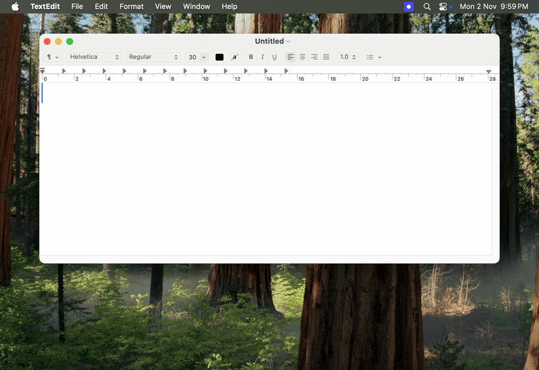

# dictation-app

Hold a hotkey, speak, release, and the text is pasted into the app that has
focus.

**Status: alpha.** macOS 13 or newer on Apple Silicon only (the DMG is
`aarch64`; no Intel build). Speech is transcribed in the cloud with your own
Groq or OpenAI API key. Windows and local (on-device) models are planned.



_Recorded in a macOS VM: a real Right Option hold, speech by macOS `say` fed to the app as audio, transcribed by Groq Whisper._

## Try it

1. Download the latest DMG from
   [Releases](https://github.com/gargankit90/dictation-app/releases/latest).
2. Follow the [tester guide](docs/TESTERS.md): install, first run, API key,
   first dictation, and how to report a bug.

## How it was built

This is a learning project built by a small team of AI agents: a Lead who
writes the milestone specs, and a Developer, a Tester and a Code Reviewer who
each work in their own sandbox, on two model families so the reviewer is
independent of the author. Every change goes through a pull request. The rules
the agents follow are in [AGENTS.md](AGENTS.md).

I write about what I learn building it [on LinkedIn](https://www.linkedin.com/in/ankitrgarg/).

Built with Tauri 2, Rust and React/TypeScript.

## Development prerequisites

Building the app needs a Mac with macOS 13 or newer. Building on other
systems is not supported yet (see the
[Tauri prerequisites](https://v2.tauri.app/start/prerequisites/) if you want
to try).

## Build it on a Mac

In order, on a clean Mac:

```sh
# 1. Apple's command line tools (compiler, git)
xcode-select --install

# 2. Rust. rustup then installs the exact toolchain from rust-toolchain.toml
#    the first time you build.
curl --proto '=https' --tlsv1.2 -sSf https://sh.rustup.rs | sh

# 3. Node 24 (see .nvmrc), for example with Homebrew; nvm or fnm work too.
brew install node@24
echo 'export PATH="/opt/homebrew/opt/node@24/bin:$PATH"' >> ~/.zshrc

# 4. The tools the quality gate and git hooks use. CI pins these versions.
brew install lefthook cargo-deny cargo-nextest cargo-llvm-cov typos-cli jq
cargo install cargo-machete --version 0.9.2 --locked
cargo install cargo-about --version 0.9.3 --locked --features cli

# 5. Clone and install
git clone https://github.com/gargankit90/dictation-app.git
cd dictation-app
npm ci
scripts/install-hooks.sh   # once per clone: git hooks, incl. the push guard
scripts/make-dev-cert.sh   # once per Mac: "dictation-app Dev" signing certificate

# 6. Run it
npm run tauri dev
```

Open a new terminal after step 3 so `cargo` and `node` are on your `PATH`
(`node@24` is keg-only in Homebrew, hence the `PATH` line). The gate
tools in step 4 are only needed to push (the pre-push hook runs the gate) and
for `scripts/gate.sh`; `npm run tauri dev` does not need them.

To build the signed `.app`, run
`npm run tauri build -- --debug --bundles app`. Builds are signed with the
self-signed `dictation-app Dev` certificate so macOS keeps the Accessibility
and Microphone permissions across rebuilds. Without it, `tauri build` stops
with "The specified item could not be found in the keychain". To build the
tester DMG, run `scripts/build-dmg.sh`; CI builds an ad-hoc-signed one as an
artifact (`.github/workflows/dmg.yml`).

## Quality gate

Every change runs the same gate (`scripts/gate.sh`): git's pre-push hook runs
it through `lefthook run pre-push-gate`, and CI runs it on GitHub-hosted
runners for every pull request and on pushes to `main`. The VM end-to-end
tests (`tests/e2e/`) are not part of CI; the maintainer runs them locally,
inside a VM on their own Mac, after each merge. Run the gate yourself with:

```sh
scripts/gate.sh
```

| Check | Command |
| --- | --- |
| Format | `cargo fmt --all --check`, `npx prettier --check .` |
| Rust lint | `cargo clippy --workspace --all-targets -- -D warnings` |
| Dependencies | `cargo deny check`, `cargo machete` |
| Rust tests | `cargo nextest run --workspace`, `cargo test --workspace --doc` |
| Coverage | `scripts/coverage.sh` (`core`, `transcribe` ≥ 85%, `app` ≥ 70%) |
| TypeScript | `npx tsc -b --noEmit`, `npx eslint . --max-warnings 0`, `npx vitest run` |
| Licence notice | `scripts/check-licences.sh` (`THIRD-PARTY-LICENSES.txt` is current; regenerate with `scripts/gen-licences.sh THIRD-PARTY-LICENSES.txt`) |
| Spelling | `typos` |
| Guards | `scripts/test-guards.sh` |

pre-commit (lefthook) runs the fast checks on staged files: `cargo fmt
--check`, `prettier --check`, `eslint`, `typos`.

## Layout

| Path | What it holds |
| --- | --- |
| `crates/core` | Pure logic: coordinator state machine, text, audio maths, settings. No I/O. |
| `crates/ports` | Traits only: the boundaries to the OS and the network. |
| `crates/platform` | OS adapters (hotkey, audio, paste, permissions, secrets) and test fakes. |
| `crates/transcribe` | Speech-to-text engines behind one trait. |
| `crates/app` | Runs the coordinator against the ports (package `dictation-pipeline`). No Tauri types. |
| `src-tauri` | Thin Tauri shell: commands, events, tray, windows. |
| `src` | React UI. |
| `scripts/` | The quality gate, git hooks, release and DMG scripts, VM helpers. |
| `tests/e2e/` | The VM end-to-end suite. Run by the maintainer, see its README. |
| `third_party/` | Patched forks of `handy-keys` and `coreaudio-rs`; each has a `PATCHES.md` saying what changed and why. |
| `docs/` | Engineering notes (`ENGINEERING.md`), the tester guide, release notes, agent role files. |
| `docs/milestones/`, `test-reports/`, `reviews/` | The agents' paper trail: each milestone's spec, test reports and code reviews. Moving to `docs/history/` soon. |

## Contributing and security

See [CONTRIBUTING.md](CONTRIBUTING.md). Report vulnerabilities privately, as
described in [SECURITY.md](SECURITY.md).

## Licence

MIT, see [LICENSE](LICENSE). Third-party code and its licences are listed in
[NOTICE](NOTICE) and `THIRD-PARTY-LICENSES.txt`.
